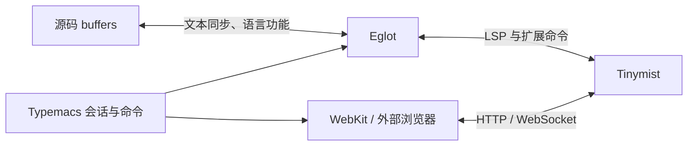

# 架构与实现边界

预览工作台复用 Tinymist 自带页面，不维护渲染器或 VS Code Webview 的副本。表格编辑直接操作源码，与预览和语言服务独立。

## 模块

| 文件 | 职责 |
|---|---|
| `typemacs.el` | 用户命令、minor mode、Eglot 注册、fallback 源码模式 |
| `typemacs-session.el` | 会话索引、源码 buffer 归属、局部资源释放 |
| `typemacs-eglot.el` | Tinymist 扩展、Eglot 兼容接口、通知与请求适配 |
| `typemacs-preview.el` | 异步预览启动、浏览器后端、WebKit 窗口 |
| `typemacs-sync.el` | 双向定位、位置编码、跟随节流 |
| `typemacs-table.el` | Typst 表格词法扫描、单元格导航、对齐及行列编辑 |

只由 Eglot 发送 `didOpen`/`didChange`/`didClose`。启动预览和手动定位前，先刷新该连接所有 managed buffers 的待发修改，以包含尚未保存的主文件和章节。渲染更新从 Tinymist 直接进入浏览器。

## 会话与生命周期

索引键是规范化的 `(project-root main-file preview-mode)`，会话保存服务连接、客户端生成的任务 ID、状态、URL、源码 buffers 及窗口。相同主文件和模式的启动请求复用任务；不同连接的旧会话不能被新连接复用。

状态为 `starting → running / failed → stopped`。启动请求只发送一次。停止会话立即清理本地状态，随后请求服务端结束任务。若启动成功回复晚于停止，再次结束旧任务，避免遗留预览。清理具有幂等性，旧任务的通知不会删除同键的新会话。

源码 buffer 离开会话只解除自身关联。最后一个源码 buffer 离开，且没有内嵌预览 buffer 时，结束任务。杀死预览 buffer 结束该任务，但不会关闭共享的 Eglot 服务。连接死亡时清理关联会话；自动恢复预览暂不实现。

## Tinymist 协议

通过 `workspace/executeCommand` 调用：

| 命令 | arguments |
|---|---|
| `tinymist.doStartPreview` | `[CLI 参数数组]`，含 task ID、主文件、模式、loopback 随机端口 |
| `tinymist.scrollPreview` | `[task ID, {event, filepath, line, character}]` |
| `tinymist.doKillPreview` | `[task ID]` |

检查服务端 `executeCommandProvider.commands`，不将这些扩展当作标准 LSP 功能。启动结果中的 `staticServerPort` 用于打开自带 HTTP 前端。

新建的 `typemacs-eglot-server` 使用初始化选项 `customizedShowDocument: true` 请求 `tinymist/preview/scrollSource`。现有普通 Eglot 连接也可使用：Typemacs 为自身会话所在目录中的 `window/showDocument` 请求提供窗口适配，其他请求交回 Eglot。处理 `tinymist/preview/dispose` 时同时匹配连接与任务 ID。

反向定位延迟到 JSON-RPC dispatcher 之外执行，避免打开文件触发嵌套请求。源码窗口与预览窗口分别保存，位置由 Eglot 按协议编码转换，不能使用屏幕列宽。光标跟随使用 buffer-local 空闲计时器，反向定位后抑制一次回传。

## 表格编辑边界

`typemacs-table.el` 自行扫描 Typst 的代码、内容块、字符串、数学公式、raw 文本与嵌套注释，不依赖 major mode 的 syntax table 或 tree-sitter。扫描结果按修改计数和可访问范围缓存；扫描时读取完整词法上下文，只选择包含光标且完全可访问的最内层完整表格，编辑不越过 narrowing 边界。

参数模型保留单元格源码和注释，将连续的表体单元格、`table.header`、`table.footer` 分为独立区段。行编辑在区段内进行，列编辑同步所有区段及字面量列宽元组。对齐按显示宽度补空格，多行内容保持原文；缺少的末行单元格显式补空。改动使用 `atomic-change-group`，相同格式不重写 buffer。

表格按键通过 keymap filter 仅在支持的单元格内生效，其他位置交还原绑定。这个模块不求值 Typst，不推断动态列数、展开内容、`table.cell` 的布局以及横竖线；显式命令对不支持的形式报错。它产生普通 buffer 修改，由已有 Eglot 同步链路发送。

## 验证范围

ERT 覆盖 Unicode/emoji/tab 与窄化 buffer 的位置转换、共享会话、重复启动、启动取消后的迟到回复、任务清理、计时器清理和浏览器回退。真实 Tinymist 测试覆盖本地 HTTP 前端、未保存的 include 文件、错误恢复、定位命令与共享语言服务。

表格 ERT 覆盖单元格导航、末行追加、行列增删和移动、表头表尾、列宽、嵌套语法与注释、Unicode 对齐、按键回退、narrowing、缓存失效及单步撤销。可用时调用真实 Typst 编译编辑后的源码。

需要图形界面手动检查：内嵌页面可见、预览点击跳回章节、源码定位滚动、焦点切换、窗口缩放、杀死预览 buffer 后侧窗消失。

参考：[Tinymist 预览文档](https://myriad-dreamin.github.io/tinymist/feature/preview.html)、[VS Code LSP 适配](https://github.com/Myriad-Dreamin/tinymist/blob/main/editors/vscode/src/lsp.ts)、[VS Code 预览实现](https://github.com/Myriad-Dreamin/tinymist/blob/main/editors/vscode/src/features/preview.ts)。
